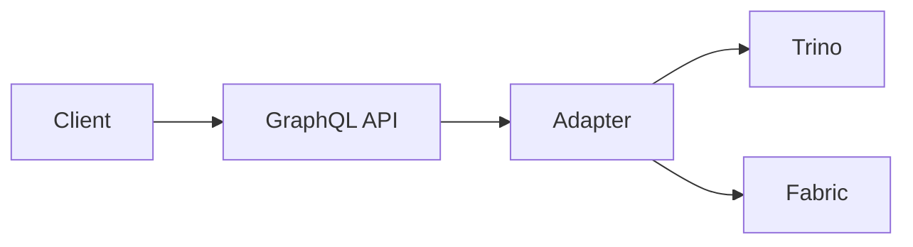

# Documentation Content Generation Rules

You are writing MDX documentation for the LakeQL project. Follow these rules strictly.

## Source of Truth

#[[file:apps/docs/src/mdx-components.tsx]]

The component map in `apps/docs/src/mdx-components.tsx` is the authoritative source for which MDX components are available. Do NOT use any component that is not registered there.

## Allowed MDX Components

You may ONLY use the following components. Do NOT invent or import other components.

### Admonitions

- `<Note>` / `<Note title="Title">` — Informational callout
- `<Callout>` / `<Callout title="Title">` — General callout
- `<Warning>` / `<Warning title="Title">` — Warning callout
- `<Error>` / `<Error title="Title">` — Error/danger callout
- `<Success>` / `<Success title="Title">` — Success callout

**Example — without title:**

```mdx
<Note>
  All adapters require a configured data source before they can execute queries.
</Note>
```

**Example — with title:**

```mdx
<Warning title="Breaking Change">
  The `connectionString` option was removed in v2.0. Use `host` and `port`
  separately.
</Warning>
```

**Example — all variants:**

```mdx
<Callout title="Tip">
  Use environment variables for connection credentials in production.
</Callout>

<Success title="Done">Your adapter is configured and ready to use.</Success>

<Error title="Connection Failed">
  Check that your Trino coordinator is reachable at the configured host and
  port.
</Error>
```

### Command

- `<Command variant="VARIANT">SUBJECT</Command>`
  - Renders package-manager-aware commands (npm/pnpm)
  - Variants: `create`, `exec`, `install`, `install-dev`, `run`
  - The text content is the command subject only (no `npm`/`pnpm` prefix)

**Example — install:**

```mdx
<Command variant="install">@lakeql/adapter-trino</Command>
```

**Example — install-dev:**

```mdx
<Command variant="install-dev">@lakeql/cli</Command>
```

**Example — run:**

```mdx
<Command variant="run">cli pull --source warehouse</Command>
```

**Example — create:**

```mdx
<Command variant="create">@lakeql/create-app my-api</Command>
```

**Example — exec:**

```mdx
<Command variant="exec">lakeql init</Command>
```

### CLI Reference

- `<CliCommandDetails command="COMMAND_NAME" />`
  - Renders auto-generated CLI option tables from `@lakeql/cli` metadata
  - Use `command="create-app"` for the scaffolding tool
  - Must match an exported command name from the CLI package
  - The page should also set `cliCommand` in frontmatter

**Example:**

```mdx
---
title: pull
description: Pull table schemas from a data source and generate TypeScript files.
cliCommand: pull
---

## Overview

The `pull` command connects to your data source, reads table metadata, and generates TypeScript interfaces.

## Options

<CliCommandDetails command="pull" />
```

### API Reference

Auto-generated TypeScript reference, read from package source at build time via ts-morph. Two ways to use it — pick one per page:

**(a) Frontmatter** — for a whole-page reference of one or more exports/files:

```mdx
---
title: API Reference
description: Auto-generated reference for adapter packages.
separator: true
apiReference:
  - name: "@lakeql/trino-client"
    file: "trino-client/src/index"
  - name: "@lakeql/fabric-client"
    file: "fabric-client/src/index"
  - name: "@lakeql/datasource"
    file: "datasource/src/index"
---
```

**(b) Inline `<ApiReference>`** — to embed a single export or a filtered set within a prose page:

| Prop | Type | Purpose |
| --- | --- | --- |
| `file` | string | Path relative to `packages/`, without extension (e.g. `query-builder/src/index`) |
| `name` | string | Render a single named export |
| `include` | string[] | Only these exports (when `name` is not set) |
| `exclude` | string[] | Drop these exports (applied after `include`) |
| `variant` | `"full"` \| `"summary"` \| `"table"` | `full` = collapsible details (default), `summary` = title+description, `table` = flat property table for one interface/type |

The `file` path is always relative to the monorepo `packages/` directory, without the `.ts` extension.

**Example — single interface as a table:**

```mdx
<ApiReference variant="table" file="trino-client/src/types" name="QueryProps" />
```

**Example — a filtered set with full detail:**

```mdx
<ApiReference
  file="api/src/index"
  include={["createApiServer", "defineApiConfig"]}
/>
```

### Stepper

- `<Stepper>` wraps `<StepperItem>` children
- `<StepperItem title="Step title">` — each step
- Content inside StepperItem supports full markdown, code blocks, and other components

**Example:**

````mdx
<Stepper>
  <StepperItem title="Install dependencies">
    <Command variant="install">@lakeql/api</Command>
  </StepperItem>
  <StepperItem title="Configure your data source">
    Create a `.env` file with your connection details:

    ```bash
    TRINO_HOST=localhost
    TRINO_PORT=8080
    ```

  </StepperItem>
  <StepperItem title="Start the server">
    <Command variant="run">dev</Command>
  </StepperItem>
</Stepper>
````

### Tabs

- `<Tabs defaultValue="VALUE">` — wrapper, `defaultValue` must match a TabsTrigger value
- `<TabsList>` — wraps triggers
- `<TabsTrigger value="VALUE">` — tab label
- `<TabsContent value="VALUE">` — tab panel

**Example:**

```mdx
<Tabs defaultValue="trino">
  <TabsList>
    <TabsTrigger value="trino">Trino</TabsTrigger>
    <TabsTrigger value="fabric">Microsoft Fabric</TabsTrigger>
  </TabsList>
  <TabsContent value="trino">
    Configure the Trino adapter by setting `TRINO_HOST` and `TRINO_PORT`.
  </TabsContent>
  <TabsContent value="fabric">
    Configure the Fabric adapter by providing your Azure tenant credentials.
  </TabsContent>
</Tabs>
```

### Accordion

- `<Accordion>` — wrapper (optional props: `multiple`, `orientation`)
- `<AccordionItem title="Section title">` — collapsible section

**Example:**

```mdx
<Accordion>
  <AccordionItem title="What query engines are supported?">
    LakeQL supports Trino and Microsoft Fabric as query engines.
  </AccordionItem>
  <AccordionItem title="Can I use multiple data sources?">
    Yes, configure multiple entries in your `datasources` configuration.
  </AccordionItem>
</Accordion>
```

**Example — multiple open:**

```mdx
<Accordion multiple>
  <AccordionItem title="Environment variables">
    All connection settings can be overridden with environment variables.
  </AccordionItem>
  <AccordionItem title="Config file">
    Alternatively, use a `lakeql.config.ts` file in your project root.
  </AccordionItem>
</Accordion>
```

### Description Lists

- `<DescriptionList>` — wrapper for term/definition pairs
- `<DescriptionListItem label="Term">Definition content</DescriptionListItem>`

**Example:**

```mdx
<DescriptionList>
  <DescriptionListItem label="catalog">
    The top-level namespace in Trino that maps to a connector instance.
  </DescriptionListItem>
  <DescriptionListItem label="schema">
    A grouping of tables within a catalog, equivalent to a database schema.
  </DescriptionListItem>
  <DescriptionListItem label="table">
    A structured data set with columns and rows accessible via SQL.
  </DescriptionListItem>
</DescriptionList>
```

### Page List

- `<PageList items={[...]} />` — a curated grid of cards linking to other documentation pages
- `items` is an array of page paths relative to `/docs` (e.g. `"lakeql/introduction/overview"`); a leading slash or `docs/` prefix is tolerated
- Each entry's **title and description are read from the target page's frontmatter**, so never pass them in — update the target page's frontmatter instead. This avoids maintaining the same text twice.
- A reference that does not resolve is skipped silently, so a typo drops an entry rather than breaking the build.
- `variant` chooses the rendering: `"card"` (default) is a grid of cards; `"list"` is a compact vertical list, better for an "in this section" or "where to next" list inside a page.

Use `PageList` for a hand-picked "where to next" or cross-level list — e.g. a subsection page that links up to sibling sections of its group. Do NOT use it (or a bullet list) to list an index page's own direct children: the directory/index route already renders those automatically as a card grid (see the "Automatic Section Grid" note below), so a manual list of the same children renders them twice. Keep such index bodies to intro prose and let the auto grid list the children.

Only reach for `items` with page paths — it reads page frontmatter, so do NOT use it for a list of code symbols or API-reference anchors (write those as prose).

**Example — list variant (links to other doc pages):**

```mdx
<PageList
  variant="list"
  items={["api/server-setup", "api/authentication", "api/schema-builder"]}
/>
```

**Example — card variant (default):**

```mdx
<PageList
  items={["lakeql/introduction/key-concepts", "lakeql/getting-started"]}
/>
```

### Automatic Section Grid (no component)

Directory and `index.mdx` pages automatically render a grid of their child pages, with each child's title and description taken from frontmatter. Do NOT hand-write a list of child pages on an `index.mdx` — keep the index body to a short intro paragraph and let the automatic grid list the children.

### Images

- `<Image src="" alt="" />` — use for explicit control over width/height/className
- Standard markdown `` — use for simple images

**Example — Image component:**

```mdx
<Image
  src="/images/architecture-diagram.png"
  alt="LakeQL system architecture"
  width={800}
  height={450}
/>
```

**Example — markdown image:**

```mdx

```

### File Tree

- `<FileTree files={[...]} />` — renders a project/file structure
- `files` is an array of path strings, or objects `{ path, description }`
- `highlight` (optional) — array of paths to visually emphasise (e.g. files a command just generated)

**Example — plain paths:**

```mdx
<FileTree
  files={["src/index.ts", "src/env.ts", "lakeql.config.ts", ".env.example"]}
/>
```

**Example — with descriptions and highlighted (newly generated) files:**

```mdx
<FileTree
  files={[
    { path: "src/env.ts", description: "Validated environment variables" },
    {
      path: "src/fabric-impersonation-resolver.ts",
      description: "OBO resolver",
    },
    "lakeql.config.ts",
  ]}
  highlight={["src/fabric-impersonation-resolver.ts"]}
/>
```

### Terminal

- `<Terminal>OUTPUT</Terminal>` — renders text as terminal output, with ANSI color support
- `title` (optional) — a label shown above the output
- Use for command _output_; use `<Command>` for the command itself

**Example:**

````mdx
<Terminal title="lakeql add fabric-obo">
```
✔ Applied feature "fabric-obo"

Changes • created src/fabric-impersonation-resolver.ts

```
</Terminal>
```
````

### Code Blocks

Code blocks are rendered via markdown fenced code with language tags. The `CodeBlock` component handles rendering automatically — you do not use `<CodeBlock>` directly in MDX.

**Supported language tags:**

- `ts` — TypeScript
- `bash` — Shell commands
- `json` — JSON
- `graphql` — GraphQL
- `sql` — SQL
- `yaml` — YAML
- `mermaid` — Mermaid diagrams (renders as a visual diagram)
- `railroad` — Railroad diagrams (renders as a visual diagram)

**Example — TypeScript:**

````mdx
```ts
import { createApiServer } from "@lakeql/api"

const server = createApiServer({
  port: 4000,
  datasource: "warehouse",
})
```
````

**Example — Mermaid diagram:**

````mdx

````

**Example — Railroad diagram:**

````mdx
```railroad
Diagram(
  Choice(0, "SELECT", "INSERT", "UPDATE"),
  Terminal("table_name")
)
```
````

## Frontmatter Requirements

Every page MUST include:

```yaml
---
title: "Page Title"
description: "Brief description of the page content (max 180 characters)."
---
```

### Optional frontmatter fields

| Field | Type | Purpose |
| --- | --- | --- |
| `navTitle` | string | Short title for sidebar (use when `title` is long) |
| `navBadge` | enum | One of: `new`, `updated`, `beta`, `experimental`, `deprecated`, `pulse` |
| `entrypoint` | string | Only on collection root `index.mdx`, points to first content page |
| `separator` | boolean | Set `true` on section index pages that act only as dividers |
| `apiReference` | array | Array of objects with `name` and `file` for auto-generated TypeScript API reference |
| `cliCommand` | string | CLI command name for auto-generated option tables |
| `toc` | boolean | Set `false` to hide table of contents on a page |
| `tags` | string[] | Array of strings for search categorization |

### Collection root `index.mdx` example

```yaml
---
title: Data Sources
navTitle: Data Sources
description: Connect LakeQL to Trino, Microsoft Fabric, and other query engines.
entrypoint: /docs/data-sources/setup/concept
---
```

### Section index `index.mdx` example

```yaml
---
title: Setup
description: Configure data source connections for your LakeQL project.
separator: true
---
```

## Content Quality Rules

1. **No hallucinated APIs**: Do NOT generate function signatures, configuration options, type names, or API endpoints that do not exist in the package source code. If uncertain, add a `TODO: requires source confirmation` marker.

2. **No placeholder text**: Never use "lorem ipsum", "TBD", "TODO" (without confirmation context), "insert X here", or "coming soon".

3. **Code fence language tags**: ALL code blocks MUST have explicit language tags:
   - Use `ts` for TypeScript, `bash` for shell, `json` for JSON, `graphql` for GraphQL, `sql` for SQL
   - Use `mermaid` for diagrams, `yaml` for YAML, `railroad` for railroad diagrams

4. **Internal links**: Use relative paths that resolve to existing page slugs. Format: `/docs/collection/section/page`. Do NOT link to pages that do not exist.

5. **File naming**: Use numeric prefixes for ordering (`01.page-name.mdx`). Use kebab-case for page names. Section directories also use numeric prefixes.

6. **Heading hierarchy**: Start with `##` (h2) in page content. The `title` frontmatter renders as h1. Do not skip heading levels.

7. **One topic per page**: Each page should address a single user task or concept. Split long pages rather than combining unrelated topics.

8. **Code examples**: Must be runnable or clearly marked as pseudocode. Prefer real imports and realistic variable names.

9. **No numeric prefixes in headings**: Do NOT prefix headings with numbers (e.g., `## 1. Install dependencies`). Use just the text (`## Install dependencies`). The document order establishes the sequence. Numeric prefixes create problematic slugs for the TOC and client-side anchor resolution.

## Collection Organization Rules

- Content is organized by USER TASK, not by package name
- When multiple packages are used together for a task, write a combined guide
- Internal packages (`@lakeql/helpers`, `@lakeql/logger`, `@lakeql/column-parser`, `@lakeql/parquet`, `@lakeql/file-generator`, `@lakeql/response-transformer`, `@lakeql/config`, `@lakeql/schema-generator`) do NOT get dedicated pages — reference inline only
- Section `index.mdx` files typically only contain frontmatter (title, description, separator)
