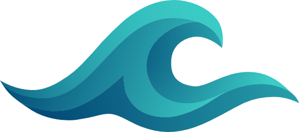

<p align="center">
  
</p>

<h1 align="center" style="border-width:0px;margin-bottom:0px">LakeQL</h1>
<div align="center" style="margin-bottom:50px;">Universal Data Access Layer for Modern Platforms</div>

<p align="center">
  <a href="https://npmx.dev/org/lakeql"></a>
</p>

LakeQL is an adapter-agnostic data access layer that lets you query across your entire data stack through one type-safe GraphQL client and a single, powerful CLI. It combines a backend runtime with a CLI that generates schema and query files from your existing data model.

The goal is to reduce manual boilerplate while keeping your API predictable, secure, and easy to extend — no matter which data platform sits underneath.

## Supported adapters

One interface, many platforms. Connect LakeQL to the data engines your team already runs on.

| Adapter | Status | Description |
| --- | --- | --- |
| **Trino** | Available | Query federated data across Trino clusters, with pushdown for joins, aggregations, and filters. |
| **Microsoft Fabric** | Available | Connect to Fabric warehouses and lakehouses, with Entra ID / On-Behalf-Of authentication. |
| **ClickHouse** | Coming soon | Sub-second analytical queries against ClickHouse clusters. |
| **DuckDB** | Coming soon | Query local or in-memory DuckDB files and Parquet datasets. |

## Features

- **Type-safe GraphQL APIs** — adapter-agnostic query generation with full TypeScript support, so you get autocomplete and compile-time checks across your data layer.
- **CLI-based schema generation** — pull live catalog metadata from your sources and generate typed schemas that stay in sync as upstream tables evolve.
- **Filtering, sorting & pagination** — built-in support for expressive filters, sorting, and pagination, rendered to each engine's SQL dialect.
- **Adapter-agnostic permissions** — define access rules per data source and table, enforced consistently across every connected adapter.
- **OpenTelemetry tracing** — optional per-data-source tracing out of the box for query latency, errors, and throughput.
- **Flexible authentication** — OAuth2, Basic Auth, and Bearer token auth with configurable impersonation strategies per data source.

## Requirements

- Node.js 24
- pnpm 12+

## Getting started

### Init project & setup

Run the following command in your terminal:

```bash
pnpm dlx @lakeql/create-app
```

Then follow the interactive setup.

The command bootstraps a project from the preconfigured template in [templates/app](./templates/app/).

### Schema generation

Run the interactive CLI to generate your schemas.

```bash
pnpm cli pull --source-path ./src
```

### Run a query

Start the server and query your generated types over GraphQL:

```graphql
query {
  orders(
    sorting: [{ field: id, direction: ASC }]
    paging: { page: 1, perPage: 10 }
  ) {
    nodes {
      id
      status
    }
    pageInfo {
      hasNext
      currentPage
    }
  }
}
```

### Local development

To start local development, run:

```bash
pnpm dev
```

### Build & Production

The template ships with a production-ready `tsdown` setup.

Use `pnpm build` to generate the production `dist` output, which you can then use in your deployment setup (for example, in a Dockerfile).

## Learn more

Full docs, guides, and examples are available at https://lakeql.dev

## Contributing

Contributions are welcome — see the [contribution guide](https://lakeql.dev/docs/lakeql/contributing/contribution-guide) to get started.

## Project background

This project has its roots in the original [datalake-graphql-wrapper](https://github.com/dbsystel/datalake-graphql-wrapper).

LakeQL was later rebuilt from the ground up as a fully type-safe, adapter-agnostic monorepo, with a complete refactoring of the codebase and architecture.

## Special thanks

- [Igal Klebanov](https://github.com/igalklebanov) and the [Kysely Team](https://github.com/kysely-org/kysely) - Kysely is used to generate valid SQL statements from GraphQL queries, and Igal helped make the query builder more generic.
- [Michael Hayes](https://github.com/hayes/pothos) - He created Pothos GraphQL, which is the foundation of our GraphQL server and its code-first schema generation approach.
