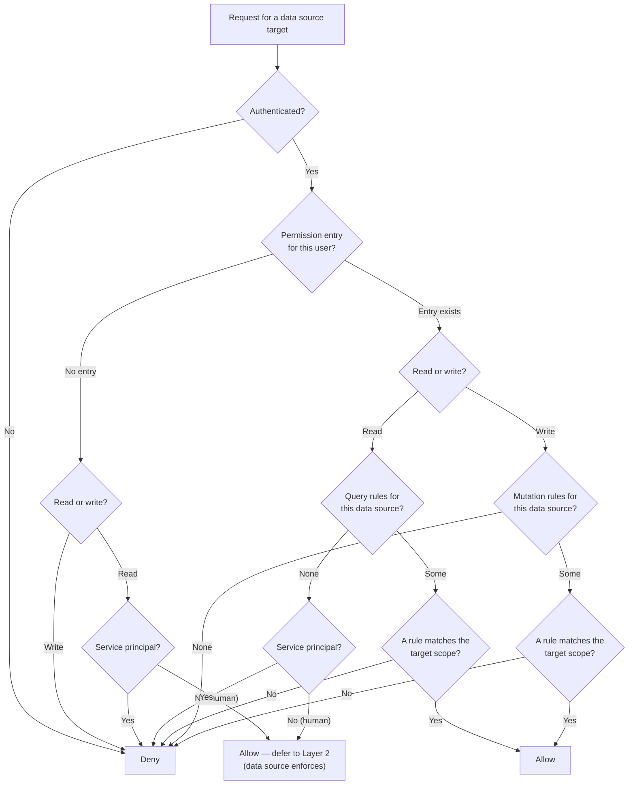

LakeQL authorizes every request in two layers. Understanding how they compose explains why an empty permission set still lets human users read, why writes are denied by default, and why impersonation is the piece that keeps the open read default safe.

## The Two Layers

**Layer 1 — LakeQL permission rules.** Before a resolver runs, LakeQL checks the request against the declared `Query` and `Mutation` rules. `hasReadPermission` and `hasWritePermission` decide whether the request is allowed to reach the data source at all. You author these rules under [`auth.permissions`](/docs/api/authentication/permissions).

**Layer 2 — the data source's own access control.** When a request passes Layer 1, it still runs against the engine (Trino, Fabric) under whatever identity LakeQL resolves for it. If [impersonation](/docs/api/authentication/trino-user-impersonation) is configured, the query runs **as the calling user**, so the engine's own rules and row-level security apply to that user. Without impersonation, the query runs with the data source's configured service credentials.

### How the Layers Compose

The two layers are not alternatives — every **allowed** request passes through both. Layer 1 is a gate: a request denied there never reaches the engine. A request that passes then runs under Layer 2, where the engine enforces its own rules under the resolved identity.

The interesting case is a **human user with no LakeQL rule**. Layer 1 allows the read (see the [read default](/docs/api/authentication/permissions#default)) and defers enforcement to Layer 2. This is safe **only if impersonation is configured** — then the query runs as that human and the engine applies its access control. Without impersonation, the same query runs with the source's service credentials, so Layer 2 enforces nothing user-specific. That is the risk the startup warning flags: with no permission rules configured, human reads are delegated to each data source's own access control, and that delegation only means something when impersonation is set up.

<Note>
  Service principals are the exception to the open read default. A service
  principal with no matching rule is denied at Layer 1, so machine callers stay
  least-privilege unless you grant them explicit rules. See the decision flow
  below.
</Note>

## Decision Flow

Both checks start from the same question — is there an authenticated user, and is there a permission entry for them — but they diverge on the default. Reads are open for humans; writes are closed for everyone. This asymmetry is deliberate: an absent or empty permission set allows human reads but denies all writes.



Every **Allow** path — whether it comes from an explicit matching rule or the human read default — then runs under the Layer 2 identity (see [Resolving Layer 2 Identity](#resolving-layer-2-identity) below). Passing Layer 1 never bypasses Layer 2; it only decides whether the request reaches the engine at all.

Scope matching is strict: omitting `catalog` matches any catalog, while `"*"` matches any schema or table. A rule scoped to a concrete catalog, schema, or table only matches a target carrying the same value. See [wildcards and scope matching](/docs/api/authentication/permissions#wildcards-and-scope-matching).

The service-principal flag comes from the identity resolver. The default Entra ID resolver marks a request as a service principal when the token's `idtyp` claim is `"app"`, or when there is no `idtyp` claim and no on-prem account claim. See [identity resolution](/docs/api/authentication/jwt-authentication#identity-resolution).

## Resolving Layer 2 Identity

Which identity a request runs under at Layer 2 is decided per data source:

1. The source's own `impersonationResolver`, if set, wins.
2. Otherwise the global `auth.impersonationResolver`, if set.
3. Otherwise no impersonation — the query runs as the system user with the source's configured service credentials.

An unauthenticated request also falls through to the system user, since there is no current user to impersonate.

How the resolver produces the per-user identity depends on the adapter: Trino sends it as the `X-Trino-User` header via [Trino user impersonation](/docs/api/authentication/trino-user-impersonation), while Fabric uses the OAuth2 On-Behalf-Of (OBO) flow configured on the [Fabric connection](/docs/data-sources/fabric/connection). In both cases the engine then applies its own access control to that identity.

## Worked Scenarios

### No LakeQL rules, impersonation configured

The common simple setup. `auth.permissions` is empty and the Trino source uses `trinoUserImpersonation()` (or the [Fabric source uses OBO](/docs/data-sources/fabric/connection)). A human runs a read:

- **Layer 1** — no permission entry, human user → allowed, deferred to Layer 2.
- **Layer 2** — the query runs as that human via `X-Trino-User` (or OBO), so Trino's access rules and any row-level security apply to them.

Enforcement lives entirely in the engine, which is often exactly what you want when the lake already defines per-user access. Writes are still denied for everyone until you add a matching `Mutation` rule.

### Explicit rules for a service principal

A technical user ingests data through the API. Because service principals are denied by default, they need explicit rules — both to read and to write:

```ts title="src/permissions.ts"
import type { Permission } from "@lakeql/config"
import { createPermission } from "@lakeql/api/helpers"

export const permissions: Permission[] = [
  {
    name: "ingestion-service",
    useSystemUser: false,
    permissions: {
      Query: [
        createPermission("warehouse", (rule) => [
          rule({ schema: "sales", tables: ["orders"] }),
        ]),
      ],
      Mutation: [
        createPermission("warehouse", (rule) => [
          rule({ schema: "sales", tables: ["orders"] }),
        ]),
      ],
    },
  },
]
```

- **Layer 1** — the entry exists, and the `Query`/`Mutation` rules for `warehouse` match the target `sales.orders`, so both the read and the write are allowed.
- **Layer 2** — the query runs under whatever identity the impersonation resolver produces for the service principal, or the service credentials when none applies.

Here Layer 1 does the real scoping. See [permissions](/docs/api/authentication/permissions) for authoring details.

### No rules and no impersonation — the danger case

<Warning>
  With no permission rules **and** no impersonation, human reads run with the
  data source's service credentials — the caller sees whatever the service
  account can. Fix it by configuring
  [impersonation](/docs/api/authentication/trino-user-impersonation) so reads
  run as the caller, or by declaring [permission
  rules](/docs/api/authentication/permissions).
</Warning>

`auth.permissions` is empty **and** neither a per-source nor a global `impersonationResolver` is configured. A human runs a read:

- **Layer 1** — no permission entry, human user → allowed, deferred to Layer 2.
- **Layer 2** — no impersonation, so the query runs with the data source's **service credentials**, not the human's identity. The engine applies its rules to the service account, not to the caller.

Human reads therefore run with the broad access the service account has, regardless of who asked. Writes are still denied, because the write default denies everyone without an explicit `Mutation` rule. This is the state the startup warning (`EMPTY_PERMISSIONS_WARNING`, printed by `createLakeQLApp`) calls out: configure impersonation, or declare permission rules, so reads are not silently running as the service account.

## Where to Next

- [Permissions](/docs/api/authentication/permissions) — author the Layer 1 `Query` and `Mutation` rules.
- [Trino user impersonation](/docs/api/authentication/trino-user-impersonation) — set up the delegation that makes Layer 2 enforce per user.
