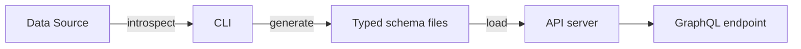

## What is LakeQL?

LakeQL is a framework that generates a type-safe GraphQL API on top of data lakehouse query engines. You point its CLI at a data source, generate typed schema files from the real table metadata, and serve them through a GraphQL server that you compose from explicit building blocks.

LakeQL supports [Trino](https://trino.io/) and [Microsoft Fabric](https://www.microsoft.com/en-us/microsoft-fabric) through adapters. A single project can register multiple adapters and route queries to different engines from one API.

## The Problem

Building a GraphQL API over lakehouse tables is repetitive. Every table needs a TypeScript interface, resolver logic, filter and sort definitions, pagination, and permission checks. When a table changes — a new column, a renamed field, an altered type — you update all of those layers by hand. Schema drift and broken types accumulate quickly across dozens of tables and several schemas.

## How LakeQL Solves It

LakeQL inverts the workflow. Instead of writing resolvers by hand, you introspect the data source and generate the typed layer:

- **TypeScript interfaces** derived from column metadata
- **GraphQL query schemas** with filtering, sorting, and pagination built in
- **JSON schemas** that drive runtime response transformation
- **Config files** that register each generated endpoint

The generated code is committed to your repository and loaded by the API server at startup. When a table changes, you re-run the introspection command and the typed layer is regenerated.

## The Shape of a Project

A LakeQL project is an ordinary TypeScript application with three moving parts:

<FileTree
  files={[
    { path: "lakeql.config.ts", description: "Adapters and data sources" },
    { path: "src/index.ts", description: "Composes and starts the API server" },
    {
      path: "src/schemas/generated/",
      description: "Generated, typed endpoint files",
    },
  ]}
/>

1. **`lakeql.config.ts`** declares which adapters are available and which named data sources exist. See [Configuration](/docs/lakeql/configuration).
2. **`src/index.ts`** loads that config, builds a runtime that owns the data source connections, and starts the GraphQL server. See [Server Setup](/docs/api/server-setup).
3. **`src/schemas/generated/`** holds the typed files the CLI writes when you introspect a table. See the [CLI commands](/docs/cli/commands).

The fastest way to get all three is to scaffold a project:

<Command variant="create">@lakeql/app my-api</Command>

## How It Works

1. **Introspect** — the CLI connects through an adapter and discovers table structures.
2. **Generate** — typed files are written: interfaces, query schemas, and configs.
3. **Serve** — the server loads the generated schemas and exposes a GraphQL endpoint.
4. **Query** — clients send GraphQL queries that translate into adapter-specific SQL.

## Where to Next

<PageList
  items={["lakeql/introduction/key-concepts", "lakeql/getting-started"]}
/>
