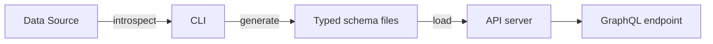

## What is LakeQL?

LakeQL is a universal data access layer for modern platforms. It generates a type-safe GraphQL API across your data stack. You point its CLI at a data source, generate typed schema files from the real table metadata, and serve them through a GraphQL server you compose from explicit building blocks.

LakeQL is adapter-agnostic. An adapter teaches it how to talk to one query engine. Adapters for [Trino](https://trino.io/) and [Microsoft Fabric](https://www.microsoft.com/en-us/microsoft-fabric) are available today. ClickHouse and DuckDB are on the roadmap. A single project can register multiple adapters and route queries to different engines from one API.

## The Problem

Building a GraphQL API over your data tables is repetitive. Every table needs a TypeScript interface, resolver logic, filter and sort definitions, pagination, and permission checks. Change a table — add a column, rename a field, alter a type — and you update all of those layers by hand. Across dozens of tables and several schemas, schema drift and broken types pile up fast.

## How LakeQL Solves It

LakeQL inverts the workflow. You introspect the data source and generate the typed layer instead of writing resolvers by hand:

- **TypeScript interfaces** derived from column metadata
- **GraphQL query schemas** with filtering, sorting, and pagination built in
- **JSON schemas** that drive runtime response transformation
- **Config files** that register each generated endpoint

You commit the generated code to your repository, and the API server loads it at startup. When a table changes, re-run the introspection command to regenerate the typed layer.

## The Shape of a Project

A LakeQL project is an ordinary TypeScript application with three parts:

<FileTree
  files={[
    { path: "lakeql.config.ts", description: "Adapters and data sources" },
    { path: "src/index.ts", description: "Composes and starts the API server" },
    {
      path: "src/schemas/generated/",
      description: "Generated, typed endpoint files",
    },
  ]}
/>

1. **`lakeql.config.ts`** declares which adapters are available and which named data sources exist. See [Configuration](/docs/lakeql/configuration).
2. **`src/index.ts`** loads that config, builds a runtime that owns the data source connections, and starts the GraphQL server. See [Server Setup](/docs/api/server-setup).
3. **`src/schemas/generated/`** holds the typed files the CLI writes when you introspect a table. See the [CLI commands](/docs/cli/commands).

Scaffold a project to get all three at once:

<Command variant="create">@lakeql/app my-api</Command>

## How It Works

1. **Introspect** — the CLI connects through an adapter and discovers table structures.
2. **Generate** — typed files are written: interfaces, query schemas, and configs.
3. **Serve** — the server loads the generated schemas and exposes a GraphQL endpoint.
4. **Query** — clients send GraphQL queries that translate into adapter-specific SQL.

## Where to Next

<PageList
  items={["lakeql/introduction/key-concepts", "lakeql/getting-started"]}
/>
