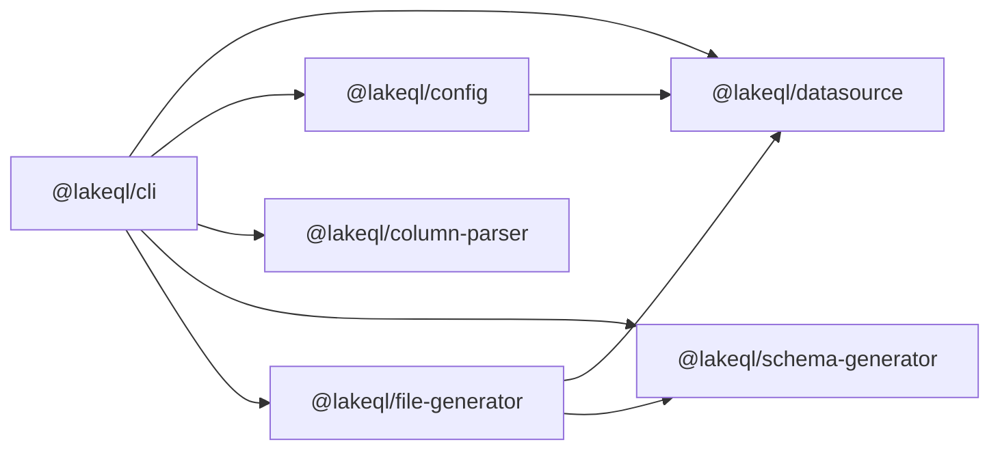
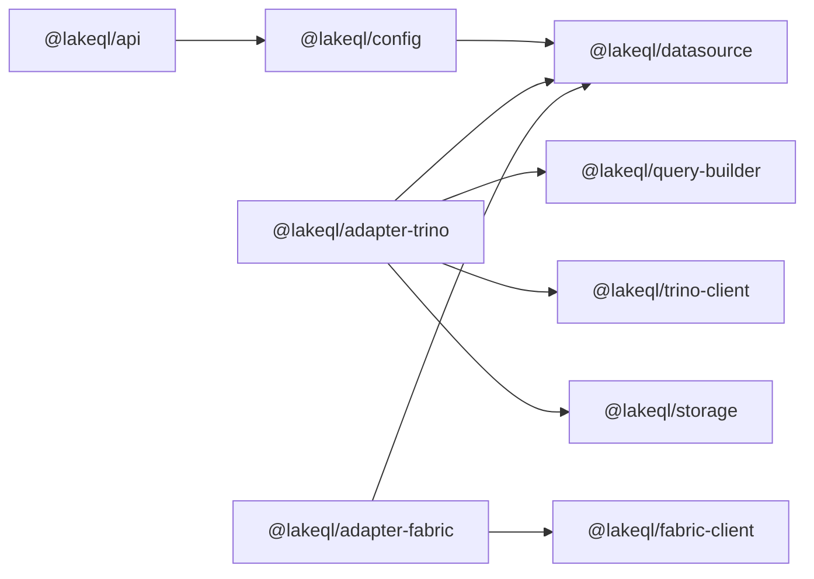

LakeQL is a monorepo of focused, single-responsibility packages. This page maps them into the layers of the [architecture](/docs/lakeql/architecture) and marks which ones an application imports directly.

## Packages You Import Directly

These are the packages a typical application depends on.

### @lakeql/config

Loads `lakeql.config.ts`, validates it, and composes the runtime that owns your data sources. Exposes `defineConfig`, `loadConfig`, and `createLakeQLRuntime`.

<Command variant="install">@lakeql/config</Command>

### @lakeql/api

The GraphQL/API runtime. Composes the schema from your generated endpoints, handles request authorization, and serves the endpoint. Exposes `defineApiConfig` and auth helpers.

<Command variant="install">@lakeql/api</Command>

### @lakeql/adapter-trino

Trino adapter: connection, read and write strategies, SQL dialect, and Trino-specific errors.

<Command variant="install">@lakeql/adapter-trino</Command>

### @lakeql/adapter-fabric

Microsoft Fabric adapter: connection, strategies, dialect, and Fabric-specific errors.

<Command variant="install">@lakeql/adapter-fabric</Command>

### @lakeql/query-builder

Builds adapter-neutral query conditions — filters, sorting, and paging — that the adapters render into their own SQL dialect.

<Command variant="install">@lakeql/query-builder</Command>

### @lakeql/cli

Introspects your data source and generates the typed endpoint files. Installed as a development dependency.

<Command variant="install-dev">@lakeql/cli</Command>

### @lakeql/create-app

Project scaffolding. Run it once to create a new LakeQL project.

<Command variant="create">@lakeql/app my-api</Command>

## Contracts and Composition

These define the interfaces everything else implements. You rarely import them directly, but they shape the public types.

| Package | Role |
| --- | --- |
| `@lakeql/datasource` | The core contracts — data source, strategies, factories, auth, capabilities, and errors. The primary contract package. |
| `@lakeql/sql-read-strategy` | Adapter-neutral SQL read orchestration and validation. |
| `@lakeql/response-transformer` | Schema-aware transformation of decoded records into typed objects. |

`@lakeql/config` sits in the composition layer: it consumes the contracts and the registered adapters, and must not depend on a concrete adapter.

## Standalone Clients

These talk to a query engine directly, below the data source abstraction. They can be used on their own. See [packages](/docs/packages).

| Package | Role |
| --- | --- |
| `@lakeql/trino-client` | Trino REST protocol client — statement submission, polling, auth, introspection. |
| `@lakeql/fabric-client` | Microsoft Fabric client — authentication and query execution. |

## Internal Packages

Used internally by the framework. You do not install these directly.

| Package | Role |
| --- | --- |
| `@lakeql/schema-generator` | Generates endpoint and mutation schemas from parsed metadata. |
| `@lakeql/file-generator` | Writes the generated TypeScript endpoint and config files. |
| `@lakeql/column-parser` | Parses engine column type strings into structured type objects. |
| `@lakeql/storage` | External-storage write pipeline, serializers, and table managers. |
| `@lakeql/parquet` | Parquet schema and serialization. |
| `@lakeql/helpers` | Shared low-level utilities. |
| `@lakeql/logger` | Shared structured logging with field redaction. |

## Dependency Flow

The packages connect through two main workflows.

An arrow means "depends on". The edges below are the actual `@lakeql` dependencies declared in each package.

### Generation (CLI)

The CLI fans out to the generation packages directly. `@lakeql/column-parser` and the standalone clients have no `@lakeql` dependencies of their own.

### Serving (API)

Adapter packages depend on the core contracts (`@lakeql/datasource`) and on the infrastructure for the strategy they provide — they never depend on `@lakeql/config`. This keeps the core free of any engine-specific code.
