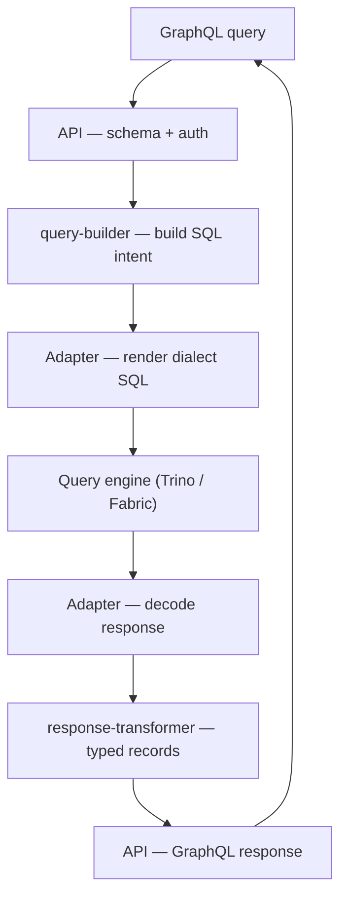

A read request flows down through the layers and back up:

1. **Query arrives** — the API server resolves the field, after checking auth and permissions.
2. **SQL intent** — the [query builder](/docs/packages/query-builder) turns the selected fields, filter, sorting, and paging into a compiled, adapter-neutral query.
3. **Dialect** — the adapter renders that into its engine's SQL and runs it.
4. **Decode** — the adapter decodes the raw protocol response into keyed records.
5. **Transform** — the response transformer applies the schema-aware mapping into typed objects.
6. **Respond** — the API returns the typed rows plus pagination metadata.

The count and the page come back together: the query builder emits two CTEs so a single round trip yields both the rows and the total used for [`PageInfo`](/docs/api/schema-builder/pagination).
