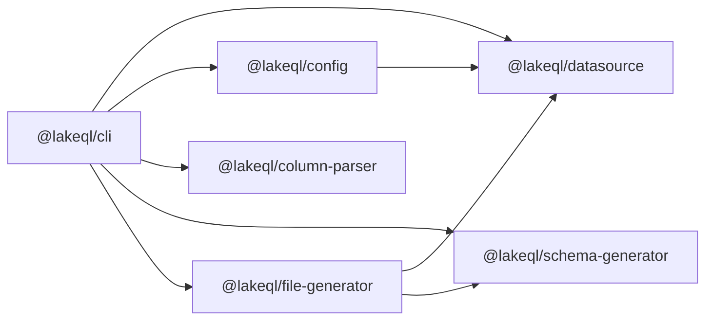
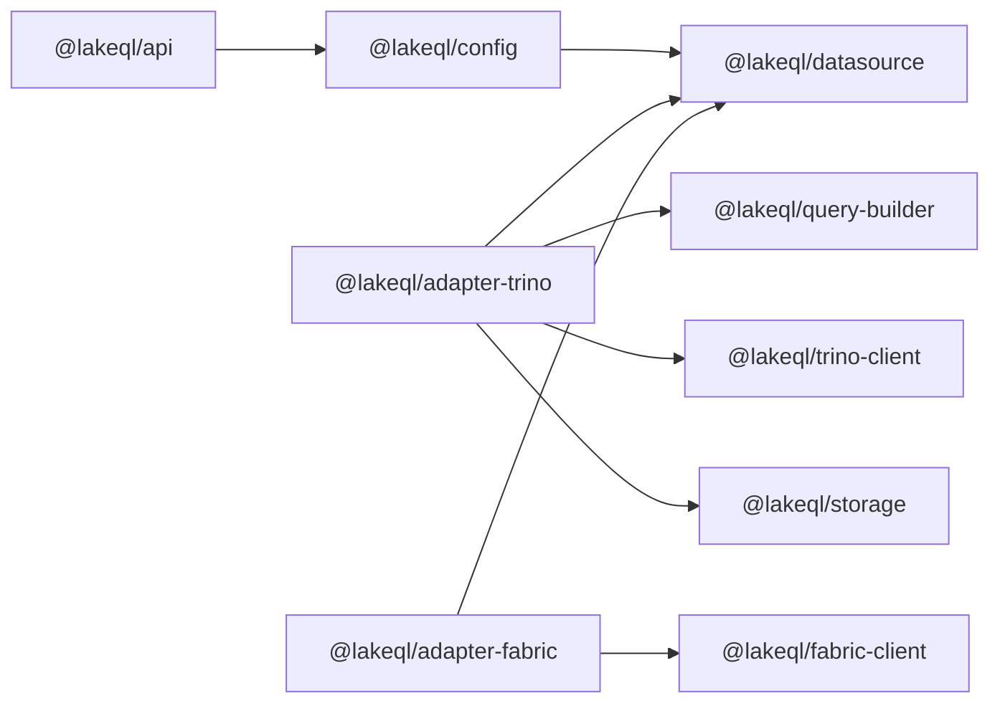

LakeQL is a monorepo of focused, single-responsibility packages. This page shows how those packages depend on each other, to help contributors understand the monorepo layering. For what an application imports, see the [package map](/docs/packages/overview/package-map).

## Layering

The packages fall into a few layers:

- **Contracts** define the interfaces everything else implements. `@lakeql/datasource` is the primary contract package. `@lakeql/sql-read-strategy` and `@lakeql/response-transformer` sit alongside it.
- **Composition** consumes the contracts and the registered adapters. `@lakeql/config` lives here. It must not depend on a concrete adapter.
- **Adapters** implement the contracts for one engine. They depend on the core contracts and on the infrastructure for the strategy they provide. They never depend on `@lakeql/config`. This keeps the core free of engine-specific code.
- **Internal packages** are used by the framework rather than imported directly by an application: `@lakeql/schema-generator`, `@lakeql/file-generator`, `@lakeql/column-parser`, `@lakeql/storage`, `@lakeql/parquet`, `@lakeql/helpers`, and `@lakeql/logger`.

## Dependency Flow

The packages connect through two main workflows. An arrow means "depends on". The edges below are the actual `@lakeql` dependencies declared in each package.

### Generation (CLI)

The CLI fans out to the generation packages directly. `@lakeql/column-parser` and the standalone clients carry no `@lakeql` dependencies of their own.

### Serving (API)

Adapter packages depend on the core contracts (`@lakeql/datasource`) and on the infrastructure for the strategy they provide. They never depend on `@lakeql/config`, which keeps the core free of any engine-specific code.
